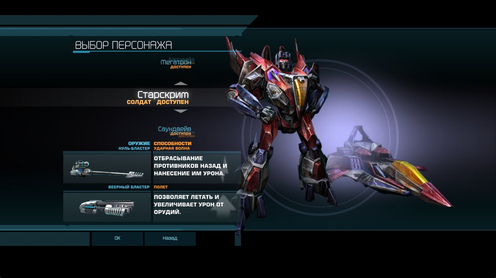
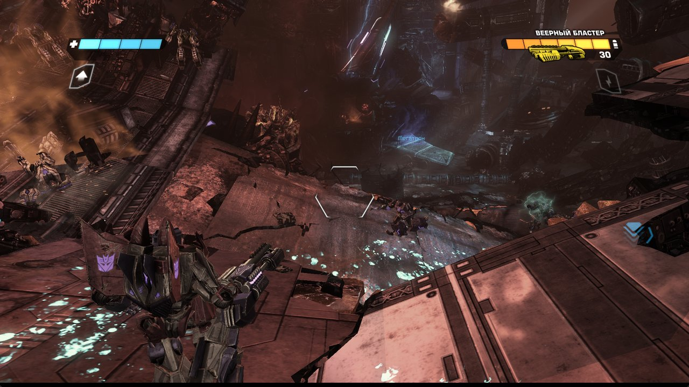
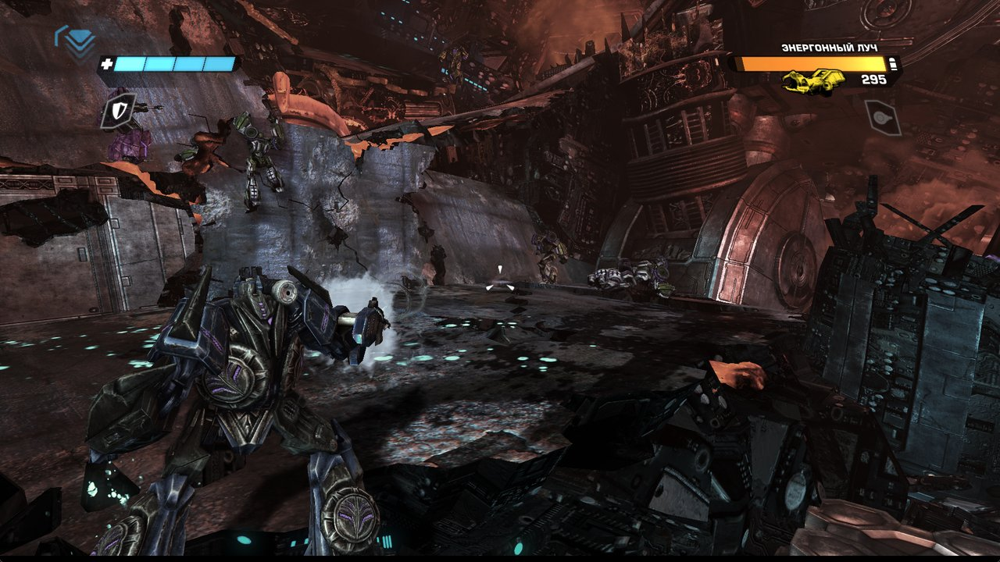

<div align="center">

# TRANSFORMERS: WAR FOR CYBERTRON — ALL CHARACTERS

**Играйте любую главу кампании за любого персонажа своей фракции, а не только за трёх героев главы**

<br />


</div>

<br />

<div align="center">
  
  <br /><br />
  
  
</div>

<br />

## О проекте

В кампании Transformers: War for Cybertron каждая глава даёт выбрать только одного из трёх героев. Этот мод открывает в каждой главе всех персонажей фракции. Можно пройти первую главу десептиконов за Старскрима или Саундвейва, а автоботов — за самолёт.

Мод ставится скриптом прямо на вашу копию игры. Файлы игры в репозиторий не входят: здесь только патчер, а все изменённые файлы сохраняются и возвращаются одной командой.

## Возможности

| | Что делает | Где |
| --- | --- | --- |
| 🧑‍🚀 **Все персонажи** | В лобби кампании доступны все персонажи фракции | `Coalesced.ini` |
| 🎮 **Персонаж в уровне** | Выбранный персонаж проходит выбор в уровне: своя модель, оружие, трансформация | карты глав |
| 📦 **Подгрузка моделей** | Модели добавленных персонажей подгружаются при загрузке главы | `DLC\AllCharacters` |
| 🔓 **Разблокировка** | Снят замок со всех закрытых персонажей | `Coalesced.ini` |
| 🧠 **4 ГБ памяти** | Флаг Large Address Aware для `TWFC.exe` — игре доступно 4 ГБ вместо 2 | `TWFC.exe` |
| 🎞️ **60 FPS** | Лимит кадров поднят с 30 до 60 | `TWFC.exe` |
| ↩️ **Откат** | Все оригиналы сохраняются и возвращаются одной командой | `--restore` |

## Персонажи

| Фракция | Персонажи |
| --- | --- |
| 🔴 **Автоботы** | Optimus Prime, Optimus, Bumblebee, Ironhide, Ratchet, Sideswipe, Warpath, Jetfire, AirRaid *(+ SilverBolt в главе A4)* |
| 🟣 **Десептиконы** | Megatron, Starscream, Soundwave, Breakdown, Brawl, Barricade, Skywarp, Thundercracker |

Jazz, Arcee, Scattershot, Zeta Prime, Shockwave, Slipstream, Deadend, Demolishor и Onslaught не включены. В обычной копии игры их данные — пустые заглушки, они есть только в мультиплеерных и DLC-файлах.

## Быстрый старт

Нужен [Python 3](https://www.python.org) (без дополнительных пакетов) и ~1.5 ГБ свободного места под резервные копии.

**1. Установка.** Укажите папку игры, в которой лежат `Binaries` и `TransGame`:

```bash
python install_mod.py "D:\Games\TRANSFORMERS - War for Cybertron"
```

**2. Игра.** Запускайте главы через **«Кампания → Выбор главы»** и выбирайте персонажа в лобби.

> При «Продолжить кампанию» из главного меню игра не подгружает модели добавленных персонажей, поэтому персонаж не из главы не появится.

> **Глава VII «Побег из тюрьмы Каона».** Вступительную катсцену нельзя пропустить, и с персонажем не из главы игра на ней вылетает. Пройдите первую контрольную точку за Оптимуса, Бамблби или Сайдсвайпа. Дальше выбирайте в «Выборе главы» вторую контрольную точку: там доступны все персонажи.

**3. Удаление.** Возвращает все оригинальные файлы:

```bash
python install_mod.py "D:\Games\TRANSFORMERS - War for Cybertron" --restore
```

## Как это устроено

| Файл | Что меняется |
| --- | --- |
| `Coalesced.ini` | Конфиг игры, обфусцирован XOR-ключом длиной 61 байт. Скрипт раскодирует 14 вложенных ini и правит два из них. В `TransLevels.ini` — список персонажей в лобби (`CampaignCharacters`). В `TransCustomization.ini` — снимает замки (`LockedCharacter=false`). |
| `*_Base_m.xxx` | Экран выбора в уровне берёт персонажей из `TnCoopInfo.PlayableCharacters`, по 3 определения `TnAiCharacterDefinition` на главу. Скрипт создаёт копии определения с другим `CharacterName` и добавляет их в список. Новые объекты и таблицы экспортов и зависимостей дописываются в конец пакета, указатели в заголовке перенаправляются, остальное не сдвигается. |
| `DLC\AllCharacters\<карта>.ini` | Раздел `[Engine.PackagesToFullyLoadForDLC]`: при загрузке главы подгружаются пакеты `TR_<имя>_ROBODEF_p` добавленных персонажей. На каждую карту нужен отдельный файл. |
| `PCTOC.txt` | Размер и md5 изменённых файлов. |
| `TWFC.exe` | Флаг Large Address Aware (1 байт заголовка) и лимит 60 FPS (4 байта в `GetMaxTickRate`). |

<details>
<summary><b>Что выяснилось по пути</b></summary>

<br />

- **Логика игры скомпилирована в `TWFC.exe`.** Байткод UnrealScript в пакетах загружается, но не исполняется, поэтому правка скриптов ничего не даёт. Работают только изменения данных и конфигов.
- **Объект можно перенести в конец пакета.** Достаточно перенаправить запись в таблице экспортов, и игра его подхватит.
- **ИИ-напарники.** Все персонажи из списка главы, кроме выбранного игроком, становятся ИИ-напарниками. Добавленные напарники используют модель «родного» героя главы. Набор отряда решает код внутри `TWFC.exe`.
- **Лимит 30 FPS.** Его нельзя снять через конфиг: функция `GetMaxTickRate` в exe возвращает константу 30.0. Мод перенаправляет её на 60.0.
- **TWFC Advanced Configurator.** Вместе с [ним](https://www.nexusmods.com/transformerswarforcybertron/mods/47) игра вылетала. С этим модом его лучше не ставить.

</details>

<br />

<div align="center">

Сделано **ZEDKODEX**

</div>
